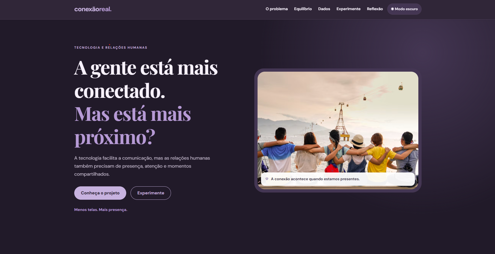

Conexão Real — Menos telas. Mais presença.

 1. Visão Geral e Preview

O Conexão Real é um projeto acadêmico desenvolvido para refletir sobre os impactos da comunicação digital nas relações humanas, com foco nos jovens profissionais.

A proposta é incentivar a valorização das relações presenciais e promover uma reflexão sobre como o uso frequente das tecnologias digitais pode influenciar a qualidade das interações, o sentimento de pertencimento e a convivência social.

O site apresenta informações sobre o tema, dados de pesquisas, recursos interativos e sugestões de atividades presenciais que podem ser realizadas com amigos, familiares e colegas.

Slogan:Menos telas. Mais presença.

Preview do projeto:  
[]

Site publicado no GitHub Pages: (https://rayka2001.github.io/conexao-real/)

2. Objetivos do Projeto

- Refletir sobre o impacto da comunicação digital nas relações humanas.
- Apresentar benefícios e desafios da comunicação mediada pela tecnologia.
- Incentivar a valorização das interações presenciais.
- Disponibilizar sugestões de atividades que estimulem a convivência.
- Utilizar recursos interativos para tornar a experiência mais informativa e participativa.

 3. Estrutura de Arquivos e Diretórios

O projeto está organizado dentro da pasta principal `front end`, conforme a estrutura abaixo:

```text
front end/
│
├── assets/
│
├── css/
│   └── styles.css
│
├── js/
│   └── app.js
│
├── AUDITORIA_IA.md
├── index.html
└── README.md
```

Descrição dos arquivos e diretórios:

- `front end/`: pasta principal do projeto.
- `assets/`: diretório destinado aos recursos de imagem e demais arquivos utilizados pelo site.
- `css/styles.css`: arquivo responsável pela estilização, identidade visual e responsividade.
- `js/app.js`: arquivo responsável pelas funcionalidades e interações em JavaScript.
- `AUDITORIA_IA.md`: documento que registra as experiências de utilização da inteligência artificial durante o desenvolvimento.
- `index.html`: arquivo principal, responsável pela estrutura e pelo conteúdo da página.
- `README.md`: documentação geral do projeto.

4. Arquitetura de Software e Funcionalidades

O projeto utiliza uma estrutura de página única (One Page), organizada em seções para facilitar a navegação e a compreensão do conteúdo.

Componentes da interface

- Página inicial: apresenta o nome do projeto, o slogan e sua proposta.
- Seção de contextualização: apresenta o problema abordado.
- Seção de benefícios e desafios: apresenta diferentes aspectos da comunicação digital.
- Seção de dados: apresenta informações de pesquisas por meio de visualização gráfica.
- Seção de atividades: oferece sugestões de experiências presenciais.
- Seção de reflexão: estimula o visitante a pensar sobre seus hábitos de comunicação.
- Seção de referências: apresenta as fontes utilizadas na pesquisa.

 Recursos interativos

- Alternância entre os modos claro e escuro.
- Questionário interativo de reflexão.
- Gráfico para visualização de dados.
- Gerador de sugestões de atividades presenciais.
- Menu de navegação responsivo.
- Painel de perguntas e respostas.

 Organização dos dados

As funcionalidades interativas são controladas por JavaScript.

O gerador de atividades utiliza informações organizadas em estruturas de dados no JavaScript. O questionário processa as respostas selecionadas pelo visitante e apresenta um resultado de reflexão.

A visualização gráfica utiliza dados relacionados às pesquisas apresentadas no site.

Os esquemas específicos dos objetos JavaScript e do conjunto de dados do gráfico serão documentados conforme as estruturas implementadas no arquivo `front end/js/app.js`.

5. Tecnologias e Dependências

As tecnologias utilizadas na estruturação do projeto são:

- HTML5: estruturação do conteúdo.
- CSS3: estilização, identidade visual e responsividade.
- JavaScript: implementação das funcionalidades interativas.

Bibliotecas externas:os nomes, as versões e os endereços CDN deverão ser identificados diretamente no código-fonte antes da finalização desta documentação.

A documentação das dependências deverá considerar somente as bibliotecas efetivamente utilizadas no projeto.

 6. Identidade Visual

A identidade visual do Conexão Real utiliza tons de roxo e lavanda, buscando transmitir acolhimento, equilíbrio e reflexão.

 Paleta de cores

| Aplicação | Cor | Código |
|---|---|---|
| Roxo principal | Roxo | `#51356F` |
| Roxo secundário | Lavanda | `#8063A6` |
| Destaques | Lilás | `#C7B2DF` |
| Fundos suaves | Lilás claro | `#EEE7F5` |
| Fundo principal | Quase branco | `#FAF8FC` |
| Texto principal | Roxo escuro | `#30283A` |

 7. Responsividade e Acessibilidade

O projeto considera a adaptação da interface a diferentes tamanhos de tela, incluindo computadores, tablets e celulares.

Também foram trabalhados aspectos de acessibilidade, como organização semântica do conteúdo, identificação de elementos interativos, navegação por teclado e alternativas textuais para imagens.

A validação final deve considerar os testes realizados em diferentes navegadores e dispositivos.

 8. Matriz de Rastreabilidade e Colaboração

O desenvolvimento e a divisão de atividades devem ser registrados de acordo com as contribuições efetivamente realizadas.

| Atividade | Responsável | Registro |
|---|---|---|
| Planejamento e definição do tema | A preencher conforme a participação real | A registrar |
| Estruturação HTML | A preencher conforme a participação real | A registrar |
| Desenvolvimento dos estilos CSS | A preencher conforme a participação real | A registrar |
| Implementação das funcionalidades JavaScript | A preencher conforme a participação real | A registrar |
| Testes e correções | A preencher conforme a participação real | A registrar |
| Documentação e auditoria de IA | A preencher conforme a participação real | A registrar |
| Versionamento e publicação | A registrar | Pendente |

O histórico de commits do GitHub deverá ser utilizado para documentar as alterações realizadas no projeto.

 9. Uso de Inteligência Artificial

Durante o desenvolvimento, foram utilizados assistentes de inteligência
