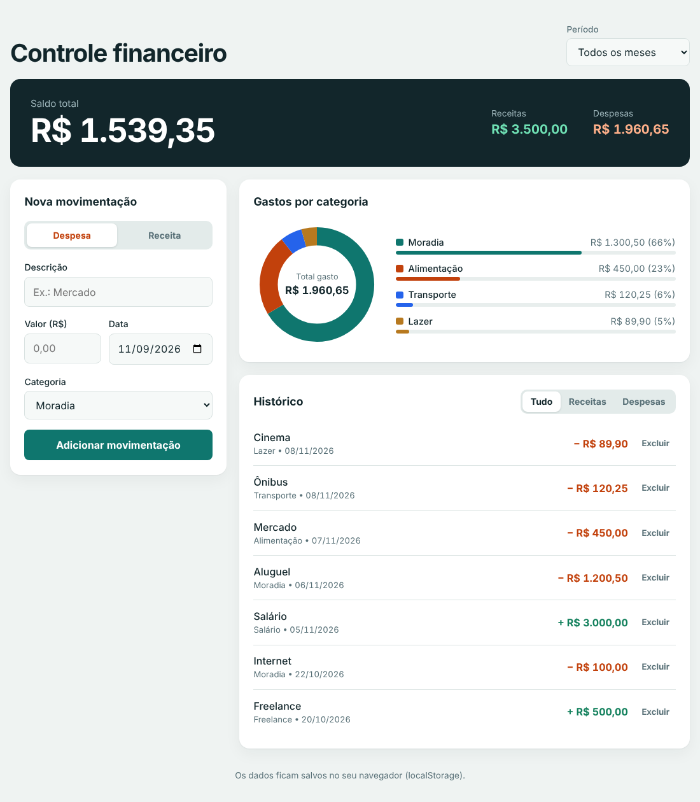

# Finance Tracker

Aplicação web de controle financeiro pessoal: registre receitas e despesas, acompanhe o saldo automaticamente e visualize para onde seu dinheiro está indo.



## Objetivo

Projeto desenvolvido durante o primeiro semestre de Engenharia de Software para praticar manipulação de dados com JavaScript, cálculos, filtros e visualização de informações, usando apenas HTML, CSS e JavaScript puro.

## Funcionalidades

- Cadastro de receitas e despesas com descrição, valor, data e categoria
- Cálculo automático do saldo, do total de receitas e do total de despesas
- Histórico de movimentações, ordenado da mais recente para a mais antiga
- Filtro por tipo (tudo, receitas ou despesas) e por mês
- Gráfico de rosca com os gastos por categoria, com legenda e percentuais
- Exclusão de movimentações
- Formatação de valores em reais (R$) e datas no padrão brasileiro
- Validação do formulário com mensagens de erro
- Dados salvos no navegador com `localStorage`
- Layout responsivo (desktop, tablet e celular)

## Tecnologias

| Tecnologia | Função no projeto |
| --- | --- |
| HTML5 | Estrutura e semântica da página |
| CSS3 | Estilo, layout com Grid/Flexbox e responsividade |
| JavaScript (ES6+) | Lógica, cálculos e manipulação do DOM |
| SVG | Desenho do gráfico de rosca, sem bibliotecas externas |
| localStorage | Armazenamento dos dados no navegador |

## Como executar

Não é necessário instalar nada.

```bash
git clone https://github.com/estermari2605-cloud/finance-tracker.git
cd finance-tracker
```

Depois, abra o arquivo `index.html` no navegador.

## Estrutura de pastas

```
finance-tracker/
├── index.html
├── css/
│   └── style.css
├── js/
│   └── script.js
├── docs/
│   └── screenshot.png
└── README.md
```

## Decisões técnicas

- **Valores em centavos:** os valores são guardados como números inteiros (centavos) para evitar erros de arredondamento comuns com decimais em JavaScript, como `0.1 + 0.2`.
- **Formatação com `Intl.NumberFormat`:** exibe moeda e datas no padrão brasileiro sem bibliotecas.
- **Gráfico com SVG:** o gráfico de rosca é desenhado com círculos SVG, o que dispensa dependências externas.
- **`textContent` em vez de `innerHTML`:** evita que texto digitado pelo usuário seja interpretado como HTML.

## O que aprendi

- Trabalhar com arrays (`filter`, `reduce`, `map`, `sort`) para calcular totais e agrupar dados
- Lidar com valores monetários de forma segura
- Desenhar gráficos com SVG a partir de dados calculados
- Aplicar filtros combinados (período e tipo) sobre os mesmos dados
- Persistir e recuperar dados com `localStorage`

## Próximos passos

- Edição de movimentações
- Exportar os dados em CSV
- Metas de gastos por categoria
- Testes automatizados

## Autora

**Ester Mari** — estudante de Engenharia de Software  
[GitHub](https://github.com/estermari2605-cloud) · [LinkedIn](https://www.linkedin.com/in/ester-mari)
